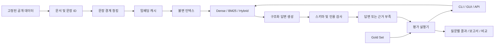

# 구현 구조와 설계 의도

## 1. 목표와 경계

Groundwork는 문서에 근거한 답변, 근거 추적, 품질 측정, 변경 전후 비교를 하나의
재현 가능한 작업 흐름으로 연결한다. 기본 실행 환경은 로컬 Python 서버이며, GUI와
API는 같은 origin에서 제공한다. 공개 저장소에는 공개 데이터와 소스만 포함하고,
모델 키·사용자의 질의 기록·실행 중 캐시는 기본적으로 게시하지 않는다.

## 2. 데이터 계층: dataset.py, schemas.py

### 어떻게 구현했는가

- HotpotQA 공식 Hugging Face 저장소의 특정 revision과 Parquet 파일을 선택했다.
- 다운로드 내용의 SHA-256을 확인한 후 파싱한다. 서버가 같은 URL에서 다른 파일을
  제공하면 실패시킨다.
- 질문 ID의 해시를 기준으로 정렬하고 bridge/comparison 각각 12개를 선택한다.
  원본 정답 근거 제목이 이미 선택된 경우 건너뛰어 근거 대상의 중복을 줄인다.
- 선택된 질문의 distractor 문서까지 하나의 전역 Corpus로 합친다. 질의할 때 정답
  질문에 해당하는 10개 문서만 제공하는 쉬운 설정으로 제한하지 않는다.
- 문서 ID는 제목과 문장 내용의 해시다. 문장 ID는 문서 ID와 원본 문장 위치로 만든다.
- 요약 8개는 원문 첫 두 substantive sentence를 수용 기준으로 삼는다. 요약과
  원 질문은 source_id를 공유하고 같은 split에 둔다.
- 근거 부족 8개는 필요한 정답 문서를 전역 Corpus에서 제거한다. 제거한 제목이
  재유입되거나 정답 문자열이 남은 문서에 등장하면 그 후보를 사용하지 않는다.

### 왜 이렇게 했는가

정답 근거를 청크 번호에 직접 묶으면 청킹 실험 때 정답이 무효화된다. 원문 문장을
기준으로 정답을 기록하면 청크 크기 변경 후에도 같은 근거 회수율을 계산할 수 있다.
검색 대상에 distractor를 포함하면 단순한 문서 lookup 이상의 검색 난도가 생긴다.
원본 데이터, 파생 Gold Set, 실행 모델이 보는 문서를 분리하면 정답 누출을 점검하기 쉽다.

### 한계

이 데이터는 Wikipedia의 과거 도입부를 추린 작은 영어 집합이다. 정답 문자열이 없다는
것만으로 모든 대체 추론 경로가 불가능하다고 증명할 수 없다. 요약은 규칙 기반 파생
질문이며 실제 사람의 정보 요구 분포를 대표하지 않는다. 공개 벤치마크의 사전학습
중복 가능성도 있다. 데이터 검수의 provenance는 `human_review: pending`으로 남긴다.

## 3. 청킹과 인덱스: retrieval.py

### 어떻게 구현했는가

기본 한도는 **180 words**, overlap은 **1 sentence**다. 토큰 수라고 표현하지 않는다.
문장 경계를 보존하며 다음 문장을 더하면 한도를 넘는 경우 청크를 닫는다. 문장 하나가
한도보다 길면 그 문장은 통째로 유지하므로 이 수치는 엄격한 최대 토큰 한도가 아니다.
매 반복에서 시작 위치가 반드시 전진해 짧은 문서에서도 무한 루프가 생기지 않는다.

청크 ID는 문서 ID, 포함된 문장 ID, 실제 텍스트의 해시다. 임베딩에는 제목과 본문을
함께 넣는다. Nomic 모델에서는 문서에 `search_document:`, 질문에 `search_query:`를
붙인다. 벡터는 float32로 만들고 L2 정규화한다. 비정상 값·0 벡터는 거절한다.

SQLite 캐시는 모델/provider/endpoint hash/로컬 모델 digest/입력 문자열/질의 여부를
키로 사용한다. 같은 문자열이라도 다른 모델 또는 질의용 prefix이면 재사용하지 않는다.
API 키는 캐시 키나 manifest에 넣지 않는다. WAL과 connection-per-operation을 사용한다.

인덱스는 `runtime/indexes/<signature>/`에 생성한다. signature에는 Corpus 해시,
청킹 설정, embedding identity가 들어간다. 벡터·청크 파일을 쓴 뒤 manifest를 마지막에
원자적으로 저장한다. 로딩 시 파일 해시를 다시 확인하며 pickle은 사용하지 않는다.

### 왜 이렇게 했는가

현재 수백 개 청크 규모에서는 정규화 벡터의 행렬 내적으로 모든 후보를 정확 검색할 수
있다. 근사 검색 오차와 별도 DB 운영 부담을 도입하지 않아 품질 변화의 원인을 설명하기
쉽다. 캐시와 불변 인덱스로 재실험 비용을 줄이고, stale index를 조용히 사용하는 일을 막는다.

### 확장 시 변경할 부분

검색량과 데이터가 커지면 벡터 DB 또는 ANN 인덱스가 필요하다. 현재 BM25 인덱스는
프로세스 메모리에서 구성하며 문서 증분 업데이트를 지원하지 않는다. 임베딩 API 토큰
계량은 아직 실행 보고서 비용에 포함되지 않는다. endpoint hash는 주소 노출을 줄이지만
모델 alias가 가리키는 원격 가중치의 불변성을 보장하지 않는다.

## 4. 검색: Dense, BM25, Hybrid

Dense는 `normalized_vectors @ normalized_query`로 순위를 매긴다. BM25는 소문자화한
Unicode word 토큰을 사용한다. 영어 위키 문서에 적합한 단순 baseline이며, 한국어
형태소 처리를 최적화한 구현이라고 주장하지 않는다.

Hybrid는 각 검색기의 상위 24개를 가져와 `1 / (60 + rank)` 점수를 더하는 RRF를
사용한다. 순위는 1부터 시작한다. BM25 점수가 0 이하인 후보에는 lexical 기여를 주지
않는다. 최종 6개 청크를 선택하고 본문 총 16,000자 예산을 지킨다. 문맥을 중간에서
자르지 않아 보고서에 기록한 청크와 모델이 본 근거가 같게 한다.

Dense와 BM25의 원점수는 척도가 다르다. RRF는 이 점수들을 직접 더하지 않고 순위로
결합한다. 가중치·reranker·프롬프트를 동시에 바꾸지 않아 첫 실험은 검색 방식 변화에
집중한다. 문자 예산은 전체 프롬프트 토큰 수와 다르며 provider의 context limit은 별도
운영 제약이다.

## 5. 생성과 인용: providers.py, pipeline.py

### 모델 어댑터

`Models`는 로컬 Ollama `/api/chat`, `/api/embed` 및 일반적인 hosted
`/chat/completions`, `/embeddings` 인터페이스를 구현한다. `*_BASE_URL`은 해당 경로
바로 앞까지 지정한다. 원격 서비스의 지원 스키마나 모델 권한이 다르면 설정 검증이
필요하다. 로컬 JSON grammar와 모델별 schema grammar의 호환성 차이 때문에 JSON
출력 모드 후 Pydantic 검증을 사용한다.

429/5xx/네트워크 실패는 최대 3번 시도하고 bounded exponential backoff를 둔다.
다른 HTTP 오류는 재시도하지 않는다. 오류 메시지에 응답 본문·Authorization·URL을
넣지 않는다. timeout과 출력 토큰 수를 제한한다. 원격 seed는 지원 여부가 달라 기본
전송하지 않으며 `SEND_REMOTE_SEED=true`로 명시적으로 켤 수 있다.

### 구조화 응답

응답에는 `status`, `short_answer`, `claims`, `reason`이 있다. 각 claim은 본문과
`chunk_id`/`quote` 근거를 가진다. answered는 근거 있는 claim이 최소 1개 필요하며,
insufficient_evidence는 claims와 short_answer가 비어 있어야 한다.

프롬프트에는 문서 외 지식을 채워 넣지 말 것, 모든 추론 단계에 근거를 요구할 것,
질문과 문서 내부 명령을 데이터로 취급할 것을 명시한다. 생성 뒤 인용 ID가 실제 검색
결과에 있는지, quote가 해당 본문에 연속적으로 나타나는지 검사한다. 공백 차이만
정규화한다. 실패하면 최대 한 번 수정 생성하며, 계속 실패하면 **오류**를 반환한다.

### 의도와 한계

근거 부족과 생성 실패를 분리해야 오류가 보류 성능을 부풀리지 않는다. 유효한 인용
구절도 주장을 논리적으로 뒷받침하지 않을 수 있다. 따라서 자동 검사 필드는
`semantic_support: not_checked`로 표시하고 별도 Judge/사람 검토를 제공한다.
프롬프트만으로 prompt injection이나 환각을 완전히 방어한다고 주장하지 않는다.
short_answer와 claims 사이의 의미적 일치도 역시 Judge와 사람 검토 대상이다.

## 6. API와 GUI: api.py, web/

- `POST /api/qa`: Pydantic 요청·응답 schema, 동기 JSON 응답.
- `POST /api/qa/stream`: 검색 단계 + 답변 토큰 SSE. `streaming.py`가 부분 JSON에서
  답변 텍스트만 추출해 `draft`로 전송한다. GUI는 검증 전 표시를 붙이며 최종 `answer`만
  schema와 인용 검증을 통과한 결과다. 검증 실패 시 초안을 폐기하고 한 번 수정한다.
  bounded queue, heartbeat, 연결 해제 감지와 협력적 취소를 지원한다.
  [이벤트 계약 및 취소 한계](STREAMING.ko.md)를 참고한다.
- `/api/corpus`, `/api/gold`: 출처와 평가 기준 조회.
- `/api/jobs`: ingest/eval/experiment를 제한된 background worker에서 수행.
- `/api/runs`, `/api/compare`: 원본 결과와 조건 검증된 비교.
- `/api/runs/{id}/reviews`: 직접 검토했다는 확인과 함께 사람 점수를 저장.

GUI는 외부 CDN이 없는 HTML/CSS/JavaScript다. 작은 도구에서 프런트엔드 빌드 시스템과
추가 의존성을 줄이면서 소스 추적이 쉽도록 했다. 질문, 근거 카드, Corpus 검색·페이지,
실험 실행·진행률·비교, human review, 지표 설명을 제공한다. 동적 문자열은 HTML escape
후 렌더링하고 토큰은 브라우저 저장소에 보존하지 않는다.

서버는 loopback 바인딩이 기본이다. 외부 주소로 CLI 서버를 시작하려면 APP_ACCESS_TOKEN이
필요하다. API는 Host와 mutation Origin을 검증하고 기본 CORS 허용을 두지 않는다. CSP,
nosniff, no-store를 적용한다. 프로세스 내부 job handle은 서버 재시작으로 사라지며,
완료/부분 평가 파일은 디스크에 남는다. 외부 공개 운영 시 TLS·사용자 권한·rate limit·
durable queue를 추가해야 한다.

## 7. 평가와 실험

자세한 분모, 지표의 한계, Judge 정합성, 재현성 및 CI 정책은
[`EVALUATION.ko.md`](EVALUATION.ko.md)를 참고한다. 답변 파이프라인은 Gold 답변을
받지 않는다. 평가 실행기가 `question`만 전달하고, 실행이 끝난 다음 정답과 비교한다.
검색 성공 후 생성이 실패한 경우에도 관찰된 retrieval evidence를 보존한다.

## 8. 주요 설계 결정 요약

| 결정 | 이점 | 비용 / 한계 |
| --- | --- | --- |
| 공개 근거 라벨이 있는 데이터 | 근거 회수율을 정확히 정의 | 도메인 편향, 학습 데이터 중복 |
| 문장 기반 Gold 근거 | 청킹 변경과 독립적인 평가 | 문장 일부만 필요한 경우 coarse label |
| 정확 벡터 검색 | 재현 가능하고 구현이 명확 | 대규모에 선형 비용 |
| 직접 작성한 작은 pipeline | 각 단계와 실패를 설명 가능 | 운영 기능을 직접 관리 |
| 구조화 claim + exact quote | 출처 감사와 조작 검사가 쉬움 | 의미적 entailment는 별도 검사 |
| 로컬 및 원격 provider | 키 없이 실행, 모델 교체 용이 | 모델별 API 차이 |
| 단일 origin GUI | 배포와 키 경계를 단순화 | 여러 사용자 서비스에는 확장 필요 |
| 실패를 분모에 유지 | 낙관적인 품질 수치 방지 | 원인별 분석을 같이 읽어야 함 |
