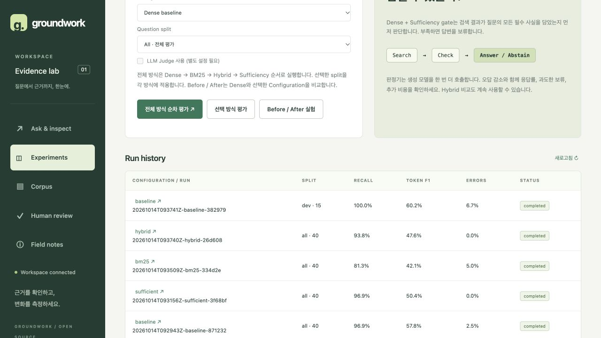

# 전체 RAG 방식 순차 평가

GUI의 **Experiments → 전체 방식 순차 평가** 또는 다음 명령으로 실행한다.

```bash
uv run groundwork benchmark --split all
```

실행 순서는 **Dense → BM25 → Hybrid (RRF) → Dense + Sufficiency**다.
선택한 split의 모든 문항을 방식마다 한 번씩 평가한다. 기본 `all`은 40 × 4 = 160문항이며,
`dev`는 15 × 4, `test`는 25 × 4다. 별도 설정한 Judge는 `--judge`로 추가할 수 있다.
모델·임베딩·가격 설정은 기존 `.env`를 사용한다.

- GUI의 Configuration 선택은 **선택 방식 평가**와 **Before / After 실험**에 적용된다.
  전체 방식 버튼은 항상 네 설정을 실행한다.
- 진행률은 현재 방식/순서, 해당 방식의 완료 문항 수, 전체 완료 문항 수를 표시한다.
- 각 실행은 기존 `runtime/runs/`에 원문 응답과 점수·오류·모델 사용량을 저장한다.
- `runtime/suites/`에는 전체 실행 상태, 진행률, 완료된 run ID 및 비교 파일 목록을 저장한다.
- 완료하면 같은 Dense 실행을 기준으로 나머지 세 방식을 각각 비교한다. `all`에서는
  all/dev/test 비교 9개를 `runtime/comparisons/`에 저장한다.
- 문항별 모델 오류도 해당 실행에 남기고 다음 문항을 처리한다. 인덱스 준비나 실행 자체의
  실패는 suite를 `failed`로 표시하고 완료한 run과 마지막 진행률을 보존한다.
- 자동 재개나 기존 기록 삭제는 수행하지 않는다. 다시 실행하면 새 기록이 생성된다.
- GUI의 job handle은 서버 재시작을 넘어서 유지되지 않지만, 저장된 run과 suite 파일은 남는다.

동일 질문·인덱스·생성 모델·프롬프트·문맥/출력 예산이 일치해야 비교할 수 있다.
실행 중 `.env` 또는 평가 설정을 바꾸지 않는다. 비용은 사용량이 반환된 생성/판정 호출의
추정치이며, 의미적 정확도와 사람 정합성은 별도 Judge/사람 평가가 필요하다.


