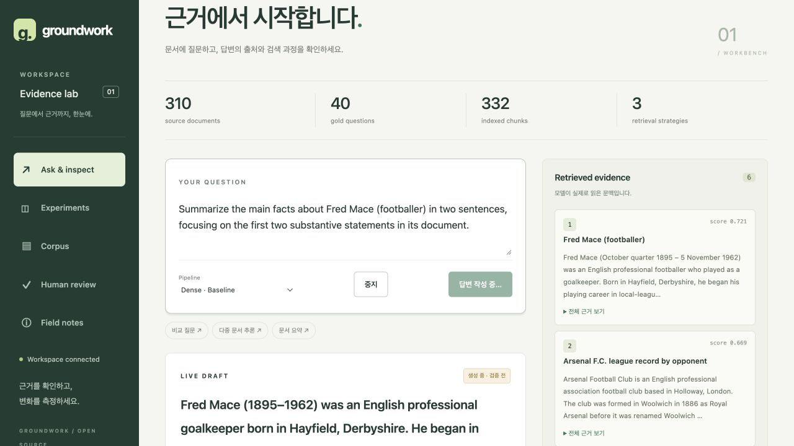

# LangChain 전환

## 실행 구조

```text
질문 → RunnableLambda(기존 Retriever.search)
     → 선택적 충분성 판정
     → ChatPromptTemplate | 공식 LangChain 채팅 모델
     → 기존 Pydantic / 인용 검사 → 답변 또는 한 번 수리
```

`langchain-core`의 Runnable을 사용한다. 생성·충분성 판정·Judge의 모델 호출이
공식 통합을 거친다. 조건 분기와 평가 실행기는 기존 Python 제어 흐름을 유지한다.

| 설정 | 통합 |
| --- | --- |
| remote, openrouter.ai | `langchain-openrouter.ChatOpenRouter` |
| remote, 그 외 호환 endpoint | `langchain-openai.ChatOpenAI` |
| ollama | `langchain-ollama.ChatOllama` |

동기는 `invoke()`, 스트리밍은 `stream()`을 호출한다. 기존 `.env`와 API·CLI·GUI를
그대로 사용한다. `uv sync --frozen` 후 서버를 재시작하면 적용된다.
LangSmith 자동 추적은 비활성화하여 별도 추적 서비스로 문서를 보내지 않는다.

## 유지한 실험 조건

- Dense baseline, BM25, Hybrid RRF, Dense+Sufficiency 설정.
- Corpus 310개, Gold 40문항과 split, 문장 청킹, 332개 청크의 기존 인덱스.
- 기존 임베딩 API, Nomic prefix, L2 정규화, 캐시 identity.
- 검색 점수·순위·동점 처리, top-k 6, candidate-k 24, RRF k=60, 문맥 예산.
- 생성·충분성·Judge 프롬프트, temperature, 출력 한도, 선택적 remote seed.
- JSON 모드, 출력 스키마·원문 인용 검사, 한 번 수리, 오류와 보류의 구분.
- Gold 분모, F1·근거 회수율·인용 지표, 비용 계산, 비교 조건과 순차 평가 순서.

`with_structured_output`이나 tool calling으로 바꾸면 제공자에게 전달하는 요청과
생성 행동이 달라질 수 있어 기존 JSON object 모드를 유지했다. 일반 호환 endpoint는
기존 `max_tokens` 및 system 역할도 보존한다. 벡터 저장소와 임베딩은 교체하지 않았다.

## 스트리밍과 오류 계약

공식 통합이 모델 요청과 응답 delta를 처리한다. 얇은 HTTP observer는 원본 usage,
원격 `[DONE]` 또는 Ollama `done:true`를 검사한다. 잘린 스트림은 실패하고 usage가
없으면 null로 남긴다. 중간 출력 이후 자동 재시도하지 않으며, SDK 내부 재시도는 끄고
기존 최대 3회 정책을 적용한다. SDK 오류 문자열에 들어갈 수 있는 키·주소·본문은
사용자 오류에 포함하지 않는다.

초안은 기존 SSE 이벤트로 전달하고 인용 검사 후 확정한다. 취소는 프레임/단계 경계에서
반영하며 멈춘 HTTP read는 timeout까지 기다릴 수 있다. [스트리밍 계약](STREAMING.ko.md).

## 검증과 기록

- 오프라인 테스트 **47개 통과**.
- 기존 4개 방식 × 40문항의 검색을 대조해 **160건 모두 청크·점수·순서 일치**.
- 데이터·설정·검색 구현 및 생성·충분성·Judge 프롬프트 변경 없음.
- 실제 Sonnet Dense 동기 응답, Sufficiency gate와 스트리밍, GUI 요약 초안과 인용 확정 확인.
- 새 manifest의 `execution`에 framework와 설치된 통합 버전을 기록한다. 이전 기록과의
  비교 결과에는 `execution_before`, `execution_after`가 함께 나온다.



`reports/sonnet-v1`은 전환 전 직접 HTTP 구현에서 측정한 원본 기록이다. 이번 검증은
검색 조건과 호출·스트리밍 동작을 확인했으며 전체 생성 품질 160문항을 다시 평가하지 않았다.
조건을 유지해도 원격 모델 응답과 지연은 달라질 수 있다. 전환 후 전체 성능을 측정하려면
기존 `uv run groundwork benchmark --split all` 또는 GUI의 전체 방식 순차 평가를 사용한다.

의존성의 실제 버전은 `uv.lock`에 고정한다. 전환 시 core 1.6.10, openrouter 0.2.9,
openai 1.7.1, ollama 1.1.0 통합을 검증했다. SDK 변경 시 요청 계약과 스트리밍 회귀
검사를 확인해야 하며, 모든 hosted endpoint와의 실호출 호환성을 보장하지 않는다.

## 참고

- [공식 OpenRouter 통합](https://docs.langchain.com/oss/python/integrations/chat/openrouter)
- [공식 Ollama 통합](https://docs.langchain.com/oss/python/integrations/chat/ollama)
