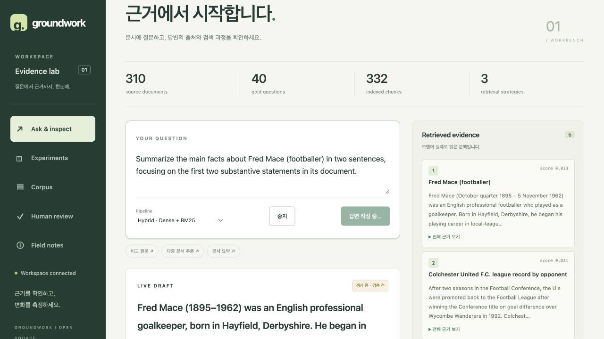

# 답변 스트리밍

GUI에서 질문하면 검색 문서를 먼저 표시하고 답변 텍스트를 도착 순서대로 보여준다.
초안에는 **생성 중 · 검증 전**을 표시한다. 생성 완료 후 JSON schema, 인용 chunk ID,
원문 구절의 존재를 검사하고 통과한 결과에만 인용 버튼을 붙인다.
이 검사는 주장의 의미적 타당성이나 정답을 보장하지 않는다.

## 전송 계약

`POST /api/qa/stream`은 기존 질문 요청(`question`, `config`)을 받고 SSE를 반환한다.
POST이므로 브라우저는 fetch의 ReadableStream을 사용한다. 원격 모델의 SSE와 Ollama의
NDJSON은 공식 LangChain 모델의 `stream()`으로 읽고 공통 이벤트로 변환한다.
HTTP 응답 observer가 원본 종료 마커와 usage를 확인해 SDK가 잘린 응답을 정상 종료로
취급하거나 누락된 usage를 0으로 채우더라도 기존 계약을 유지한다.
모델의 delta가 여러 토큰을 묶을 수 있다.

| 이벤트 | 의미 |
| --- | --- |
| `retrieving`, `evidence` | 검색 시작 및 실제 검색 결과 |
| `checking_sufficiency`, `sufficiency` | 선택한 구성에만 적용되는 충분성 판정 |
| `generating`, `draft_reset` | 답변 생성 시작, 이전 시도의 초안 제거 |
| `draft` | `short_answer`, `claims` 텍스트 배열, `reason`, `attempt`, `verified:false` |
| `model_attempt` | 완료한 모델 호출의 실제 모델명, usage, 추정 비용 |
| `validating` | 완성된 출력의 schema와 인용 검사 |
| `repairing` | 잘못된 초안을 폐기하고 수정 시도 |
| `answer` | 검사를 통과한 최종 결과. `/api/qa`와 같은 구조 |
| `error`, `done` | 실패 설명 및 스트림 종료. `done`만으로 성공을 판단하지 않음 |

`draft`는 텍스트 누적 스냅샷이므로 이전 초안을 대체한다. 인용 ID/quote와 모델의
숨겨진 reasoning은 부분 JSON에서 노출하지 않는다. 끊어진 escape와 Unicode는 완성될
때까지 보류한다. HTML은 escape하여 표시한다. 충분성 판정은 완성된 결과만 전달하며,
근거 부족 판정에서는 답변 생성 호출을 건너뛴다.

## 실패, 취소, 사용량

- 잘못된 schema/인용은 초안을 지우고 최대 한 번 수정한다. 수정도 실패하면 오류다.
- 연결 중단, 제공자의 스트림 오류, 종료 마커 누락을 최종 답변으로 승격하지 않는다.
- 일부 응답을 전달한 뒤에는 요청을 자동 재시도하지 않는다. 전송 전 일시적 오류만
  제한적으로 재시도한다.
- 중지 버튼은 fetch를 취소하고 초안을 폐기한다. 서버는 연결 해제와 cancellation
  event를 감지하고 다음 프레임/단계 경계에서 upstream 연결을 닫는다. 멈춰 있는 HTTP
  read는 timeout까지 지연될 수 있으며, 제공자 내부 처리와 과금의 즉시 중단은 보장하지 않는다.
- 서버 queue는 64개 이벤트로 제한하고, 유휴 연결에는 15초마다 heartbeat를 보낸다.
- 최종 usage 프레임까지 읽어 `attempts[].usage`와 비용을 계산한다. 제공자가 usage를
  보내지 않으면 null이다. 취소된 호출의 최종 usage는 없을 수 있다.
- `timings.first_draft_ms`는 검색과 선택적 gate를 포함해 첫 비어 있지 않은 초안까지의
  시간이다. 내부 reasoning을 포함한 모델 자체의 첫 토큰 시간과는 다르다.

`POST /api/qa`, CLI ask, 평가 harness는 기존 동기 경로를 사용한다. 스트리밍은 전달
방식을 추가하며 검색 설정·생성 프롬프트·평가 기준을 바꾸지 않는다. 원격 추론은
동일한 설정에서도 응답이 달라질 수 있다.
