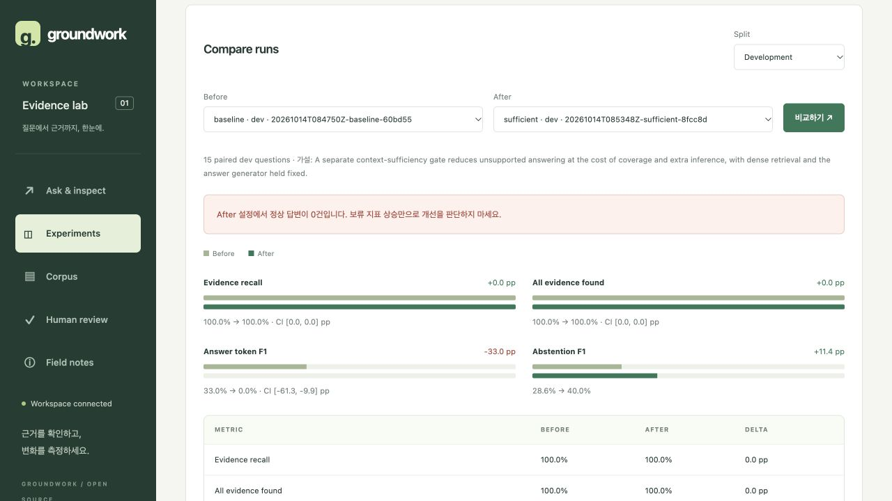

# Context sufficiency gate: 개발 비교 결과

## 결론

**현재 Llama 3 로컬 모델의 프롬프트 기반 충분성 판정은 개선에 실패했다.**
답변 불가 질문의 오답은 줄었지만, 새 설정은 정상 답변을 전혀 생성하지 않았다.
기본 설정으로 승격하지 않고 명시적으로 선택하는 비교용 베이스라인으로 유지한다.

## 가설과 통제 조건

동일한 Dense 검색 결과에 별도 충분성 판정을 적용하면 근거 없는 답변을 줄일 수 있다는
가설을 평가했다. 답변 생성 프롬프트와 입력, 생성 모델, seed, temperature, top-k,
문맥 예산, corpus/index를 고정했다. 생성 모델과 같은 모델을 판정에 추가 호출했다.

- Before: `20261014T084750Z-baseline-60bd55`
- After: `20261014T085348Z-sufficient-8fcc8d`
- 두 실행 모두 코드 `0416e77861c78cb3bee687307671dbdfe669cf15`, 시작 시 clean.
- 개발 질문 15개: 답변 가능 12개, 답변 불가 3개. 질문 및 검색 결과가 동일하다.
- 모델: `llama3:latest`; 실제 digest는 각 manifest 참조.
- 연구의 학습된 판정기 재현이 아닌, 충분성 개념을 차용한 zero-shot 프롬프트 실험이다.

## 결과

| 지표 | Dense | Dense + gate |
| --- | ---: | ---: |
| 근거 회수율 (답변 가능 질문) | 100% | 100% |
| 모든 Gold 근거 확보율 | 100% | 100% |
| 전체 답변 가능 질문 Token F1 | 33.01% | 0% |
| 정상 답변 | 11/15 | 0/15 |
| 정상 보류 | 4/15 | 12/15 |
| 시스템 오류 | 0/15 | 3/15 |
| 답변 불가 질문에 답함 | 2/3 | 0/3 |
| 답변 가능 질문을 보류함 | 3/12 | 9/12 |
| 답변 가능 질문의 시스템 오류 | 0/12 | 3/12 |
| 보류 precision | 25% | 25% |
| 보류 recall | 33.33% | 100% |

나머지 답변 가능 3개도 오류로 끝났으므로 gate의 보류율 75%를 성공률로 해석하면 안 된다.
보류 F1은 28.57%에서 40%로 올랐지만, 응답률이 0%가 되었다는 사실이 훨씬 중요하다.
정상 답변이 없으므로 인용 유효성과 응답한 항목의 F1은 0점이 아니라 N/A이다.
의미적 Judge는 실행하지 않았으며 사람이 채점한 결과도 아니다.

## 추가 추론 비용

- Before: 답변 호출 19회 (수리 포함), 입력 22,909 / 출력 2,280토큰.
- After: 충분성 호출 21회 (수리 포함), 답변 호출 0회, 입력 24,771 / 출력 2,500토큰.
- 15개 중 6개에서 판정 수리 호출이 발생했고 3개는 수리 후에도 실패했다.
- 오류 행의 응답 받은 호출 사용량도 합산했다. 임베딩과 사용량 없는 실패 요청은 제외한다.
- 가격을 설정하지 않아 금전 비용은 unknown이다. 로컬 실행이라고 비용을 0으로 기재하지 않는다.
- Before 일부 구간은 기존 GUI 실험과 모델 런타임을 공유했고 GUI 질의도 1회 검증했다.
  지연 시간은 저장되어 있지만 인과적인 속도 비교에는 사용할 수 없다.

## 실패 분석

### 1. 답을 뒷받침하는 문장이 있어도 부족하다고 판단

Fred Mace 질문에서 판정기는 1919년에 Stalybridge Celtic에 합류했다는 문장을 직접
인용하면서, 그 해 어느 팀에서 뛰었는지 정보가 없다고 판단했다. 이 사례는 검색 실패보다
판정기의 문맥 이해/충분성 판단 실패를 가리킨다. 전체 개발 세트의 Gold 근거는 모두
검색되었으나, 기계적 근거 회수와 모델의 활용 능력은 다르다.

### 2. 출력 계약 준수 실패

3개 질문에서 두 차례 모두 `invalid_sufficiency_schema`로 실패했다. 첫 실패 질문을
별도 1회 재호출해 확인했을 때, 모델이 evidence 배열에 빈 quote를 넣었다. 해당 입력은
비어 있지 않은 인용문을 요구하는 계약에 위배된다. 이 진단 호출은 본 비교 30개에 포함하지 않는다.
다른 실패도 모두 같은 세부 원인이라고 가정하지 않는다.

### 3. 올바른 보류 사례도 존재

Ann/Nancy Wilson의 밴드와 기타 브랜드 질문에서는 관련 문서가 검색됐지만 후원 관계를
입증할 정보가 없어 보류했다. 단일 성공 사례를 전체 성능 개선으로 일반화할 수 없다.
답할 수 있는 질문도 거의 모두 거부한 점이 결정적인 한계다.

## 해석 범위와 다음 단계

이 실험은 **현재 모델·프롬프트 조합이 실패했다는 개발 결과**다. 충분성 연구 전체나
더 강한 판정기의 효과를 반박하는 결과가 아니다. 반복 검색, 학습된 판정기, 확률 보정,
faithfulness Judge를 구현하거나 검증했다고 주장하지 않는다.

다음 실험은 다음 순서가 적합하다.

1. synthetic 예시로 충분/불충분 양쪽 결정을 설명한 few-shot 판정기를 별도 설정으로 비교.
2. 답변 생성 모델을 고정하고 판정 모델만 교체하는 실험; 추가 비용을 분리 기록.
3. 답변 가능 질문의 과도한 보류를 줄인 뒤, 누락 정보 기반 제한된 추가 검색을 실험.
4. 개발 세트 확대와 사람의 충분성 라벨 확보. 최종 검증에는 새 평가 세트를 먼저 고정.

현재 dev 15개와 이전에 분석한 test 25개는 새로운 독립적 검증 데이터가 아니다.
이번 결과를 보고 같은 데이터에 맞춰 수정한 다음 일반화 성능으로 보고해서는 안 된다.

세부 지표와 질문별 결과는 `METRICS.md`, `comparison-dev.json`, 각 실행의
`predictions.jsonl` 및 `manifest.json`에 보존했다. 이전 `reports/local-v1` 결과는 그대로 유지했다.

## GUI 비교 화면

